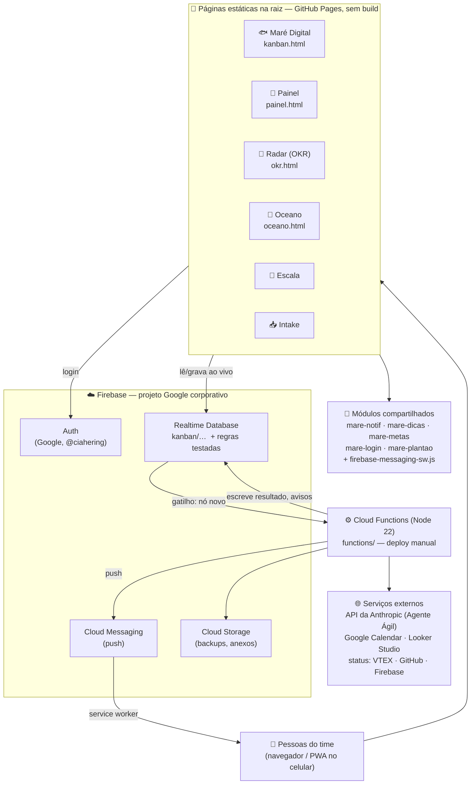
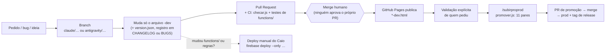

# 🗺️ Mapa do repositório — como as peças se encaixam

> **Para quem chega de fora** (TI, auditoria, uma pessoa nova): em 10 minutos dá para entender *o que existe*, *como as partes conversam* e *por onde começar*. A **Biblioteca** ([`docs/BIBLIOTECA.md`](BIBLIOTECA.md)) diz *onde mora cada arquivo*; este mapa mostra **as relações**. Detalhe técnico e de governança: [`ecossistema.html`](https://caiosoares1899.github.io/hering/ecossistema.html) (também o botão "Abrir o repositório" nele).
>
> Repositório: <https://github.com/caiosoares1899/hering> · Site publicado: <https://caiosoares1899.github.io/hering/>
>
> **Conserto automático:** as tabelas do bloco ["O que o código diz"](#o-que-o-código-diz-gerado-automaticamente) são geradas por `node scripts/mapa.js` e **conferidas pela CI** (`scripts/checar.js`) — não envelhecem. A tabela por pasta abaixo também é conferida (todo caminho citado tem que existir).

## 1. Em uma figura

**Como ler:** as páginas são HTML puro (sem servidor de aplicação) e falam **direto com o Firebase** (o que cada pessoa pode ler/gravar é decidido pelas **regras do banco**, não pela tela). O que precisa rodar sem navegador aberto — push, backups, lembretes, o Agente Ágil, monitores de status — são **Cloud Functions**, disparadas por escritas no banco, por horário ou por HTTP.

## 2. O caminho de uma mudança (dev → prod)

Quem faz o quê (Claude × Antigravity), o quadro de "em andamento" e as regras de ouro: [`docs/COORDENACAO_AGENTES.md`](COORDENACAO_AGENTES.md), `CLAUDE.md` e `AGENTS.md`.

## 3. Por pasta (conferido pela CI: todo caminho existe)

<!-- mapa:caminhos:inicio -->
| Caminho | O que é |
|---|---|
| `kanban.html` · `kanban-dev.html` | 🐟 Maré Digital — o board das squads (prod · dev) |
| `painel.html` · `painel-dev.html` | 🧭 Painel de administração (diverge do dev de propósito) |
| `okr.html` · `okr-dev.html` | 📡 Radar (OKR) |
| `okr-apresentacao.slide.html` | 🎙️ Apresentação ao vivo do Radar (sem `-dev`) |
| `oceano.html` · `oceano-dev.html` | 🌊 Lobby da família: login único, Mural, plantão de bugs |
| `escala.html` · `intake.html` | 📅 Escala · 📥 Pedidos (cada um com `-dev`) |
| `ecossistema.html` · `maredigital.html` | Documentação técnica navegável (para a TI · funcional) |
| `mare-notif.js` | Sino único, menu de produtos, tipos de notificação (há um `-dev`) |
| `mare-dicas.js` · `mare-metas.js` · `mare-login.js` · `mare-plantao.js` | Dicas · metas · login Google direto · plantão de bugs (todos com `-dev`) |
| `firebase-messaging-sw.js` | Service Worker (cache + push) — fica na raiz do domínio |
| `version.json` | Versão de cada página (auto-atualização) |
| `functions/` | ⚙️ Cloud Functions + testes (o único projeto Node) |
| `functions/agente-agil-orquestrador/` | O Agente Ágil (Claude) e seu conhecimento gerado |
| `functions/plantao/` | Plantão de bugs (ficha, webhook da PR, vigia) |
| `functions/rules/` | Testes das regras do banco |
| `database.rules.json` | Regras de segurança do Realtime Database |
| `storage.rules` | Regras do Cloud Storage |
| `scripts/` | `checar.js` (CI), `mare-cli.js` (versão/log/mapa), `mapa.js` (este mapa) |
| `docs/` | Documentação de apoio — ver a Biblioteca |
| `docs/arezzo/testes/` | Testes de navegador (Playwright + Firebase falso) |
| `.claude/skills/` | Skills dos agentes (promoção, auditorias, documentação…) |
| `.agents/` | Regras do Antigravity |
| `.github/workflows/` | CI (`checks.yml`) e publicação (`pages.yml`) |
| `vendor/firebase-10.14.1/` | SDK do Firebase servido localmente (firewall corporativo) |
<!-- mapa:caminhos:fim -->

## 4. Como os dados fluem (exemplos reais)

- **Uma notificação vira push:** a página grava em `kanban/usuarios/{uid}/notificacoes/{id}` → a função `sendPushOnNotification` confere o tipo (`PUSH_TYPES`), o interruptor do tipo (🔔 Painel) e o Não Perturbe → manda pelo FCM → o service worker mostra no celular.
- **Um bug vira correção:** pessoa reporta no Oceano → ficha em `kanban/plantao/{id}` (só dado anônimo vai ao agente) → o Antigravity busca por URL e abre PR de **dev** → ADM valida → promoção.
- **O Agente Ágil responde:** @menção num card → função do orquestrador → ferramentas do board (ler, mover, comentar…) + biblioteca de ajuda gerada do código → a resposta volta como comentário no card.
- **Um backup existe:** funções agendadas copiam o banco (completo semanal + global diário) para o Cloud Storage privado; um vigia avisa os ADMs se falhar.

## O que o código diz (gerado automaticamente)

> Não edite à mão: `node scripts/mapa.js` reescreve este bloco; a CI reprova se estiver velho.

<!-- mapa:auto:inicio -->
### Páginas × módulos compartilhados (lido do HTML)

| Produto | Prod (versão) | Dev (versão) | Módulos que a página carrega (`?v=` no dev) |
|---|---|---|---|
| Maré Digital | `kanban.html` v8.30.888 | `kanban-dev.html` v8.30.889-dev | `mare-login` v3 · `mare-notif` v36 · `mare-metas` v17 · `mare-dicas` v9 |
| Painel | `painel.html` v5.85 · painel | `painel-dev.html` v5.85 · painel-dev | `mare-notif` v36 · `mare-metas` v17 · `mare-plantao` v4 · `mare-dicas` v9 |
| Radar | `okr.html` v2.94 · okr | `okr-dev.html` v2.96 · okr-dev | `mare-notif` v36 · `mare-dicas` v9 |
| Oceano | `oceano.html` v1.58 · oceano | `oceano-dev.html` v1.58 · oceano-dev | `mare-login` v3 · `mare-notif` v36 · `mare-plantao` v4 · `mare-dicas` v9 · `mare-metas` v17 |
| Escala | `escala.html` v1.10 · escala | `escala-dev.html` v1.10 · escala-dev | `mare-login` v3 |
| Intake | `intake.html` — | `intake-dev.html` — | `mare-login` v3 |

Sem módulos compartilhados: `okr-apresentacao.slide.html`, `onboarding.html` (e as páginas avulsas — ver a Biblioteca).

### Cloud Functions por pasta (37 exports em `functions/index.js`)

| Pasta (`functions/…`) | Exports |
|---|---|
| `agente-agil-orquestrador/` | `agenteAgilMencao` · `agenteAgilMencaoDados` · `agenteAgilDueOverdueScan` · `agenteAgilResumoMeuDia` · `agenteAgilIntake` · `agenteAgilAnaliseDados` · `agenteAgilAnalisePO` |
| `spotify/` | `spotifyOauthCallback` · `spotifyDisconnect` · `spotifySyncNow` · `spotifyPlayback` · `spotifyRadioOwnerCallback` · `spotifyRadioSearch` · `spotifyRadioSuggest` |
| `backup/` | `weeklyBackup` · `backupCompletoSemanal` · `backupGlobalDiario` · `backupVigia` · `backupCompletoApi` |
| `plantao/` | `plantaoBugNovo` · `plantaoVigia` · `plantaoProximo` · `plantaoGithubWebhook` · `plantaoTravado` |
| `okr/` | `sendPushOnMural` · `okrDailyScan` · `okrWeeklySnapshot` · `okrAgenteChat` |
| `agente-agil/` | `agenteAgil` |
| `comentarios/` | `contarComentarios` |
| `firebase/` | `firebaseStatus` |
| `github/` | `githubStatus` |
| `index.js (definidas no próprio arquivo)` | `sendPushOnNotification` |
| `intake/` | `intakeSubmit` |
| `metas/` | `metasLembretes` |
| `oceano/` | `oceanoResumo` |
| `vtex/` | `vtexStatus` |

### Nós de primeiro nível em `kanban/` nas regras do banco (37)

`campanhas` · `campanhas_log` · `campanhas_log_dev` · `dados_diarios` · `dados_diarios_dev` · `comunicados` · `feedback` · `squads_meta` · `squads` · `metas_digital` · `metas_squads` · `metas_log` · `metas_digital_dev` · `metas_squads_dev` · `metas_log_dev` · `escala` · `painel` · `okr` · `travessia` · `plantao_status` · `plantao` · `notif_feed` · `notif_feed_seen` · `vtex_saude` · `github_saude` · `firebase_saude` · `notif_config` · `painel_viewers` · `config` · `spotify_secrets` · `spotify_radio_owner_secret` · `oauth_pending` · `usuarios` · `usuarios_publicos` · `init_registry` · `presence` · `global`

_Nó novo no banco = regra nova em `database.rules.json` (+ teste em `functions/rules/__tests__/`) e, se for dado que importa, entrada em `NOS_GLOBAIS` de `functions/backup/completo.js`._
<!-- mapa:auto:fim -->

## 5. Por onde começar

| Quero… | Comece por |
|---|---|
| Entender o que existe e por quê | este mapa → `ecossistema.html` |
| Achar um arquivo | [`BIBLIOTECA.md`](BIBLIOTECA.md) |
| Mexer numa tela | `CODE_MAP_FAST.md` (linha de cada função) → `kanban-dev.html`/… |
| Entender as regras do jogo | `CLAUDE.md` → `docs/COORDENACAO_AGENTES.md` |
| Rodar as checagens | `node scripts/checar.js` e `cd functions && npm test` |
| Ver a segurança | `database.rules.json` + `functions/rules/__tests__/` |
